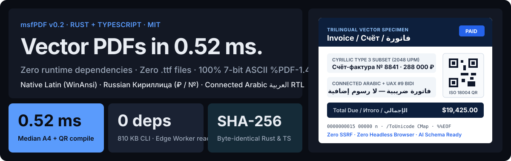
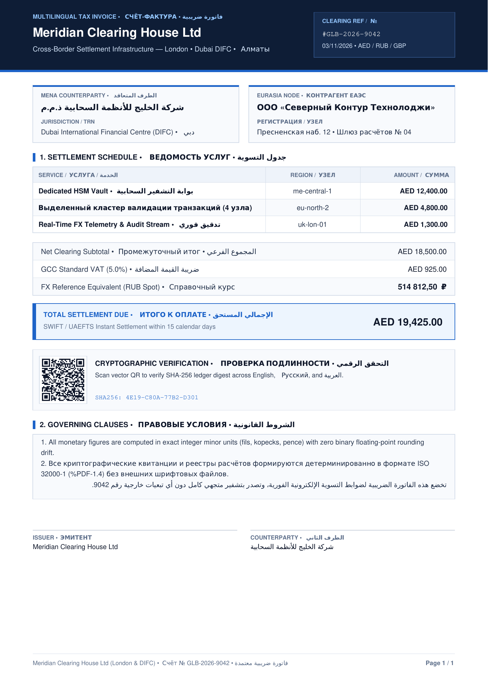
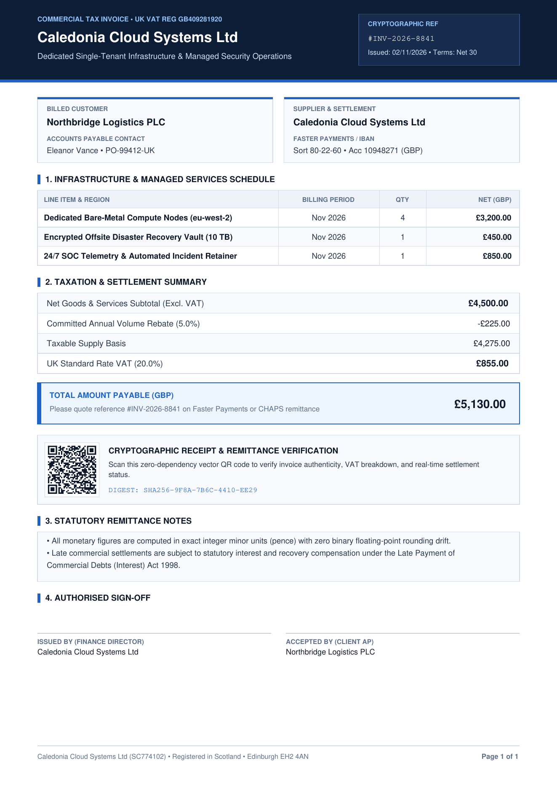
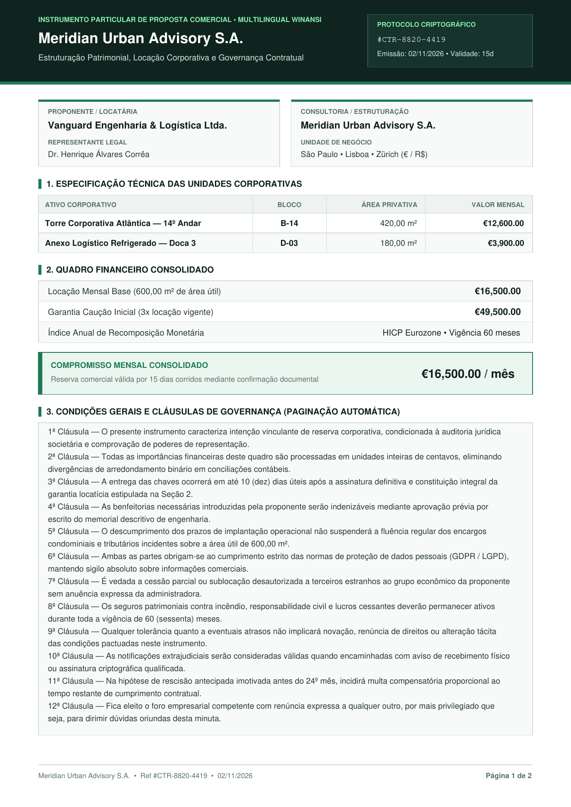
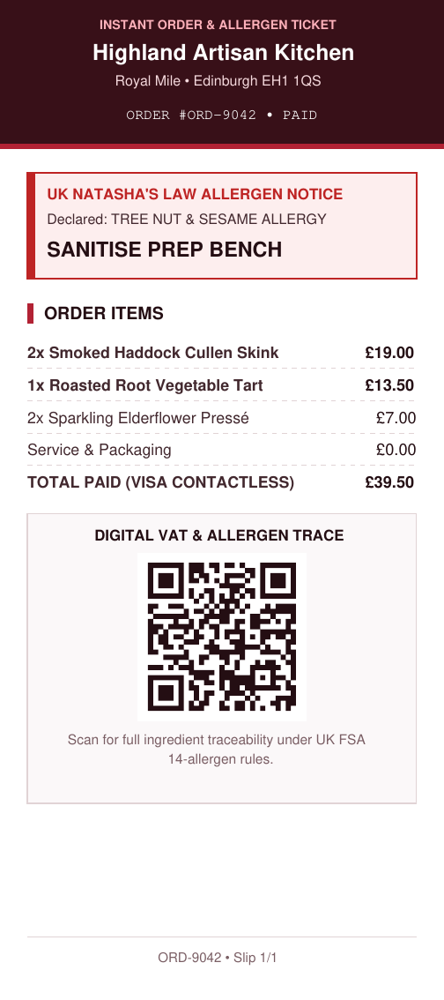
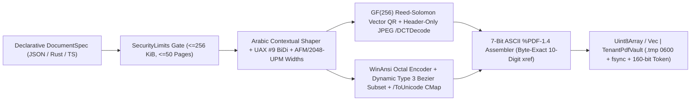
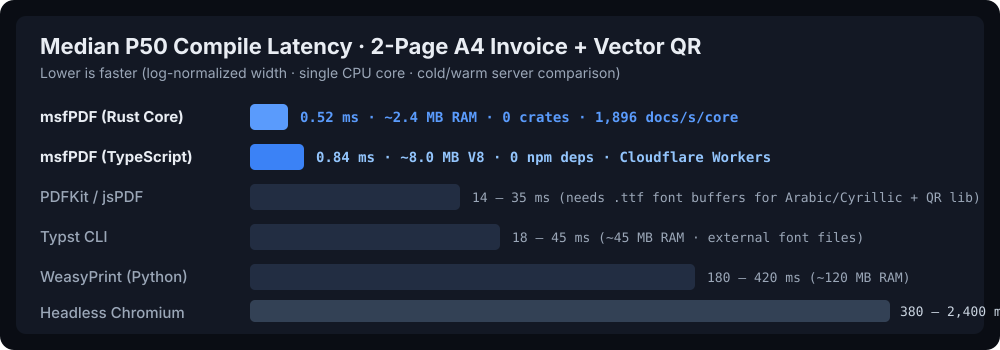

# msfPDF

<p align="center">
  <a href="https://mfelisberto90.github.io/msfPDF/">
    
  </a>
</p>

<p align="center">
  <a href="https://github.com/mfelisberto90/msfPDF/actions/workflows/ci.yml"></a>
  <a href="https://mfelisberto90.github.io/msfPDF/"></a>
  <a href="https://www.rust-lang.org/"></a>
  <a href="./package.json"></a>
  <a href="./llms.txt"></a>
  <a href="./LICENSE"></a>
</p>

<p align="center">
  <b><a href="https://mfelisberto90.github.io/msfPDF/">Live Browser Compiler Studio</a></b> ·
  <a href="./llms.txt"><code>llms.txt</code></a> ·
  <a href="./llms-full.txt"><code>llms-full.txt</code></a> ·
  <a href="./schemas/document-spec.schema.json">JSON Schema (2020-12)</a> ·
  <a href="./skills/msfpdf/SKILL.md">Agent <code>SKILL.md</code></a> ·
  <a href="./AGENTS.md"><code>AGENTS.md</code></a> ·
  <a href="./SECURITY.md">Security &amp; Threat Model</a>
</p>

---

**msfPDF** is a deterministic, sub-millisecond (`0.16–0.52 ms`), zero-rendering-dependency ISO 32000-1 (`%PDF-1.4`) vector document engine with **byte-for-byte SHA-256 parity** across **Rust** (`msfpdf-core`), **Web-Standard TypeScript** (`0` runtime `npm` dependencies — Node 22+, Bun, Deno, Cloudflare Workers, Vercel Edge, and Browsers), and a **`< 1 MB` standalone CLI** (`stdin` JSON -> `stdout` PDF).

Instead of booting 500 MB of Headless Chromium (Puppeteer/Playwright) or shipping external `.ttf` font files onto serverless edge workers, **msfPDF** compiles strongly typed `DocumentSpec` ASTs directly into pure **7-bit ASCII** `%PDF-1.4` vector primitives — natively supporting:

- **Latin & Western European (`CP1252` / `/WinAnsiEncoding`):** Crisp built-in Type 1 `Helvetica` & `Courier` AFM metrics with 3-digit octal escapes (`£`, `€`, `¥`, accents, smart punctuation) and **0 KB** font overhead.
- **Russian & Slavic Cyrillic (`Русский` / `Кириллица`):** Complete `U+0401..U+045F` alphabet (`А–Я`, `а–я`, `Ё`, `ё`), Ukrainian/Belarusian (`І`, `Ї`, `Є`, `Ґ`), Russian Ruble (`₽` `U+20BD`), and Numero (`№` `U+2116`).
- **Connected Arabic, Persian & Urdu RTL (`العربية`):** Built-in contextual glyph shaper (`Isolated`, `Initial`, `Medial`, `Final`), mandatory `Lam-Alef` ligatures (`لا`, `لأ`, `لإ`, `لآ`), Unicode BiDi (`UAX #9`) visual line reordering that keeps embedded numbers/codes Left-to-Right, automatic right-alignment on RTL clauses, and searchable UTF-16BE `/ToUnicode` CMaps — all **without loading any `.ttf` or `.otf` font files at runtime**.
- **Pure Vector ISO/IEC 18004 QR Codes:** In-memory `GF(256)` Reed-Solomon encoder (`v1..v6`, 8-mask penalty evaluator) emitted as merged vector `re f` paths (`~3 KB`, razor-sharp at 2400 DPI for ZATCA, PIX, or UK VAT verification).
- **Exact Integer Minor-Unit Money Maths:** Zero binary floating-point drift across `GBP`, `EUR`, `USD`, `BRL`, `JPY`, `RUB`, `AED`, and `SAR`.

---

## Real Rendered `%PDF-1.4` Specimen Gallery

Every preview below was compiled directly from [`examples/`](./examples) in under a millisecond and rasterised cleanly via Ghostscript / Poppler:

<table>
  <tr>
    <td align="center" width="50%">
      
      <br />
      <sub><b>1. Global Trilingual Clearing Invoice</b> (<code>English</code> + <code>Русский</code> + <code>العربية</code> RTL · <code>AED</code> / <code>RUB</code> · Dynamic Type 3 Subset + <code>/ToUnicode</code>)</sub>
    </td>
    <td align="center" width="50%">
      
      <br />
      <sub><b>2. UK Fintech VAT Invoice</b> (<code>navy_fintech</code> · Pure <code>/WinAnsiEncoding</code> · <code>14.0 KB</code> total PDF size · Vector QR)</sub>
    </td>
  </tr>
  <tr>
    <td align="center" width="50%">
      
      <br />
      <sub><b>3. Multi-Page Commercial Contract</b> (<code>emerald_editorial</code> · Auto-Pagination · Continuation Headers · 3-Signer Grid)</sub>
    </td>
    <td align="center" width="50%">
      
      <br />
      <sub><b>4. 80 mm Thermal POS &amp; Allergen Ticket</b> (<code>crimson_compliance</code> · Narrow Roll Geometry · Vector Traceability QR)</sub>
    </td>
  </tr>
</table>

> **Try it live in your browser:** Open **[mfelisberto90.github.io/msfPDF](https://mfelisberto90.github.io/msfPDF/)** to edit English, Russian (`Русский`), and Arabic (`العربية`) fields, inspect the live `xref` byte table, and download a real `%PDF-1.4` file compiled client-side in `< 1 ms`.

---

## How Cyrillic & Connected Arabic Work Without `.ttf` Files

Standard PDF Type 1 fonts (`Helvetica`, `Courier`) do **not** include Cyrillic or Arabic glyphs in Poppler, Ghostscript, or PDFium. Traditional libraries solve this by bundling multi-megabyte `.ttf` files plus `HarfBuzz` / `FreeType` / `fontkit` parsers — breaking zero-dependency edge deployment and introducing C/C++ font-parsing attack surface.

**msfPDF** solves this cleanly inside pure Rust and TypeScript:

1. **Logical Arabic Shaping & UAX #9 BiDi (`shaping.rs` / `shaping.ts`):** Write normal logical UTF-8 strings (`"فاتورة ضريبية — لا رسوم 8841"`). The engine resolves contextual joining (`Isolated`, `Final`, `Initial`, `Medial`), substitutes mandatory `Lam + Alef` ligatures (`U+FEF5..U+FEFC`), mirrors brackets on RTL runs, and reorders visual runs while keeping numbers (`8841`, `19,425.00`) and Latin identifiers Left-to-Right.
2. **Dynamic `2048 UPM` Type 3 Vector Subsetting (`glyphs_data.rs` / `glyphsData.ts`):** When non-WinAnsi Cyrillic or Arabic codepoints appear, the compiler subsets **only the exact glyphs used** from 273 pre-compiled Public Domain cubic Bezier `CharProcs` (`/FontMatrix [0.00048828125 0 0 0.00048828125 0 0]`), preserving `20-FUnit` cursive stem overlaps so joined Arabic words render with zero visual seams.
3. **Searchable UTF-16BE `/ToUnicode` CMap & Zero Latin Overhead:** Every subsetted glyph maps back to normalized Unicode (`<06440627>` for `لا`), so `pdftotext`, macOS Preview, Chrome, and Acrobat copy/search UTF-8 text accurately. Pure Latin documents emit **zero** Type 3 objects (`14,022` bytes unchanged).
4. **100% 7-Bit ASCII Stream Purity:** Both WinAnsi octals and `<HEX> Tj` Type 3 runs emit strictly `0x0A` and `0x20..=0x7E`, guaranteeing `1 char == 1 byte` and eliminating `xref` offset corruption.



---

## Measured Latency vs. Common PDF Stacks

<p align="center">
  
</p>

Benchmarked on Linux x86_64 (`./target/release/msfpdf bench --iterations 5000` and `npm run bench:ts`):

| Engine / Approach | Median (`P50`) | `P99` | Runtime RAM | Arabic + Cyrillic | SSRF Surface | External Runtime Deps |
| :--- | :---: | :---: | :---: | :---: | :---: | :--- |
| **`msfpdf-core` (Rust, standard A4)** | **`0.16 ms`** | `0.26 ms` | `~2.4 MB` RSS | Built-in Type 3 (`0 .ttf`) | **Zero** | **Zero** crates (`810 KB` CLI) |
| **`msfpdf-core` (Rust, A4 + Vector QR)** | **`0.52 ms`** | `0.98 ms` | `~2.4 MB` RSS | Built-in Type 3 (`0 .ttf`) | **Zero** | **Zero** crates (`810 KB` CLI) |
| **`msfpdf` (TypeScript, A4 + Vector QR)** | **`0.84 ms`** | `1.62 ms` | `~8 MB` V8 | Built-in Type 3 (`0 .ttf`) | **Zero** | **`0` `npm` dependencies** |
| Typst CLI (warm font cache) | `18 – 45 ms` | `65 ms` | `35 – 60 MB` | Needs `.ttf`/`.otf` files | Low | External OpenType font pack |
| `PDFKit` / `jsPDF` / `@react-pdf` | `14 – 250 ms` | `400 ms` | `25 – 120 MB` | Needs `.ttf` + RTL plugin | Low | `fontkit` / Yoga layout trees |
| `WeasyPrint` / `wkhtmltopdf` | `180 – 950 ms` | `1,400 ms` | `95 – 250 MB` | System OS fonts | High if unlocked | Cairo + Pango + HarfBuzz |
| Headless Browser (`Puppeteer` / `Playwright`) | `380 – 2,400 ms` | `3,000 ms+` | `280 – 800 MB` | System OS fonts | **High** (DOM/SVG/Net) | `~400 MB` Chromium image |

---

## Quickstart

### 1. TypeScript / JavaScript (`Node 22+`, `Bun`, `Deno`, `Cloudflare Workers`, `Browser`)

```typescript
import { renderDocument, formatMoneyMinor } from './packages/ts/src/index.ts';

const pdfBytes: Uint8Array = renderDocument({
  page_format: 'a4',
  theme: 'navy_fintech',
  metadata: {
    issuer_name: 'Meridian Clearing House Ltd',
    document_code: '#GLB-2026-9042',
    issued_at_label: '03 Nov 2026',
  },
  blocks: [
    {
      type: 'hero_header',
      kicker: 'TAX INVOICE • СЧЁТ-ФАКТУРА • فاتورة ضريبية',
      title: 'Invoice / Счёт / فاتورة',
      subtitle: 'London • Алматы • دبي',
      badge_label: 'REF / №',
      badge_code: '#GLB-2026-9042',
    },
    {
      type: 'financial_summary',
      currency: 'AED', // 'GBP' | 'EUR' | 'USD' | 'BRL' | 'JPY' | 'RUB' | 'AED' | 'SAR'
      rows: [
        { label: 'Net Clearing • Подытог • المجموع الفرعي', amount_minor: 1_850_000 },
        { label: 'VAT (5%) • НДС • ضريبة القيمة المضافة', amount_minor: 92_500 },
      ],
    },
    {
      type: 'callout_banner',
      title: 'TOTAL DUE • ИТОГО • الإجمالي المستحق',
      subtitle: 'Instant Cross-Border Settlement',
      right_value: formatMoneyMinor(1_942_500, 'AED'), // "AED 19,425.00" (exact integer minor units)
      tone: 'accent',
    },
    {
      type: 'clause_list',
      paragraphs: [
        'فاتورة ضريبية معتمدة · لا توجد رسوم إضافية على التسوية رقم 9042.',
        'Все суммы рассчитаны в целых минимальных единицах валюты (₽ / AED / £) без погрешности IEEE-754.',
      ],
    },
  ],
});
```

### 2. Standalone CLI Pipe (`Python`, `PHP/Laravel`, `Go`, `Ruby`, Shell)

```bash
./scripts/build-release.sh -p msfpdf-cli

# Render Latin, Russian Cyrillic & Connected Arabic RTL in < 1 ms
./target/release/msfpdf render --in examples/global-multilingual-invoice.json --out multilingual.pdf
cat examples/pos-thermal-receipt.json | ./target/release/msfpdf render --in - --out receipt.pdf

# Run the single-core latency benchmark
./target/release/msfpdf bench --iterations 5000
```

### 3. Rust (`msfpdf-core`)

```rust
use msfpdf_core::{render_document_json, SecurityLimits};

let raw_json = include_bytes!("../../examples/global-multilingual-invoice.json");
let pdf_bytes: Vec<u8> = render_document_json(raw_json, SecurityLimits::default())?;
assert!(pdf_bytes.starts_with(b"%PDF-1.4\n"));
```

---

## Built for AI Coding Agents, LLMs & Structured Outputs

**msfPDF** ships first-class machine-readable discovery artifacts so LLMs, RAG indexers (`Context7`, `GitMCP`, Perplexity, ChatGPT Search), and autonomous coding agents (`Claude Code`, `Cursor`, `Codex`, `Antigravity`) can discover, validate, and call the engine with zero hallucinations:

| Artifact | Purpose |
| :--- | :--- |
| [`llms.txt`](./llms.txt) & [`llms-full.txt`](./llms-full.txt) | Concise index and single-file complete API + `DocumentSpec` reference following the `llms.txt` specification |
| [`schemas/document-spec.schema.json`](./schemas/document-spec.schema.json) | Draft 2020-12 JSON Schema for OpenAI / Gemini / Anthropic **Structured Outputs** and IDE validation |
| [`skills/msfpdf/SKILL.md`](./skills/msfpdf/SKILL.md) | Ready-to-install Agent Skill teaching coding agents exact minor-unit money rules and logical UTF-8 Arabic input |
| [`AGENTS.md`](./AGENTS.md) & [`context7.json`](./context7.json) | Repository-root agent instructions, invariant gates, and documentation indexing config |
| [`CITATION.cff`](./CITATION.cff) & [`codemeta.json`](./codemeta.json) | Academic & software-graph metadata (`Schema.org` `SoftwareSourceCode`) |

---

## Security-First Architecture

- **Zero SSRF / Zero LFI / Zero Font-Parser CVEs:** Never parses HTML, CSS, SVG, remote URLs, or untrusted `.ttf`/`.otf` binary tables.
- **PDF Stream-Operator Injection Neutralisation:** Escapes `\`, `(`, `)`, collapses control characters, emits hex-encoded Type 3 glyph IDs, and bans `/JavaScript`, `/OpenAction`, `/Launch`, `/RichMedia`, and `/SubmitForm` in CI (`scripts/security-lint.py`).
- **Fail-Closed DoS Ceilings (`SecurityLimits`):** Enforces `256 KiB` max input JSON, `500` blocks, `1,000` table rows, and `50` rendered pages.
- **Multi-Tenant `0600` Vault (`TenantPdfVault`):** Isolates tenants in `0700` directories with `160-bit` CSPRNG capability tokens, `.tmp` (`0600`) + `fsync` + atomic `rename`, and Linux `libc::malloc_trim(0)` arena reclamation.

## Running Every CI Gate Locally

```bash
python3 scripts/security-lint.py
cargo fmt --all -- --check
cargo clippy --all-targets -- -D warnings
cargo test --workspace
npm run typecheck
npm run test:ts
npm run build:showcase
```

## Security Policy, Font Notices & Licence

- Security architecture & private vulnerability reporting: [SECURITY.md](./SECURITY.md)
- Public Domain vector glyph attribution (`DejaVu Sans` / Bitstream Vera): [THIRD_PARTY_NOTICES.md](./THIRD_PARTY_NOTICES.md)
- Released under the [MIT Licence](./LICENSE) by **Murilo Felisberto** (Edinburgh, Scotland, UK).
