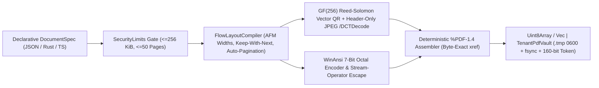

# msfPDF

[](https://github.com/mfelisberto90/msfPDF/actions/workflows/ci.yml)
[](https://www.rust-lang.org/)
[](./package.json)
[](./LICENSE)

If you're spinning up 500 MB of headless Chromium just to emit a commercial invoice or an 80 mm allergen slip, you're burning RAM and adding 500-1,500 ms of tail latency. Worse still, you're opening your backend to HTML/SVG Server-Side Request Forgery (SSRF). Yet when you drop down to raw PDF byte writers, you'll usually end up hand-calculating `(x, y)` coordinates and watching `£` or `ã` corrupt your `xref` byte offsets in Adobe Acrobat.

I've built **msfPDF** as my clean-room, zero-rendering-dependency ISO 32000-1 (`%PDF-1.4`) vector document engine. You get 1:1 parity across **Rust**, **Web-Standard TypeScript** (`0` runtime `npm` dependencies), and a **standalone CLI** (`stdin` JSON to `stdout` PDF). Feed the same declarative `DocumentSpec` JSON into either runtime and you'll get **byte-identical** `%PDF-1.4` output in **0.16-0.47 ms**. Out of the box, we ship Standard Type 1 typography, `/WinAnsiEncoding` octal accents, pure Galois-Field `GF(256)` vector QR codes, automatic multi-page flow pagination, and an optional `0600` atomic multi-tenant vault.

<table>
  <tr>
    <td align="center" width="38%">
      
      <br />
      <sub><b>A4 Fintech Invoice</b> (<code>navy_fintech</code> - GBP <code>\243</code> - Vector QR)</sub>
    </td>
    <td align="center" width="38%">
      
      <br />
      <sub><b>Multi-Page Contract</b> (<code>emerald_editorial</code> - Auto-Paginated Clauses)</sub>
    </td>
    <td align="center" width="24%">
      
      <br />
      <sub><b>80 mm POS Slip</b> (<code>crimson_compliance</code>)</sub>
    </td>
  </tr>
</table>

## Why I Built It to Run Under Half a Millisecond

Most PDF toolkits spend their CPU budget parsing HTML/CSS, running Flexbox solvers, loading multi-megabyte `.ttf` font files from disk, and subsetting OpenType glyph tables on every single request. You don't need any of that for structured commercial documents.

Every PDF viewer on earth already ships with the 14 Standard Type 1 fonts (`Helvetica`, `Helvetica-Bold`, `Courier`) built right in. I designed **msfPDF** to target those built-in font metrics directly using Adobe Font Metrics (AFM) advance-width tables while emitting pure 7-bit ASCII content streams:

1. **Zero `xref` byte-offset drift**: Raw UTF-8 characters like `£` (`0xC2 0xA3`), `€`, `ç`, `ã`, `m²`, or em-dashes take up multiple bytes and silently wreck your PDF `/Length` and `xref` offsets in strict parsers like Ghostscript, Poppler, and Acrobat. Our `pdf_escape_win_ansi` encoder declares `/Encoding /WinAnsiEncoding` and maps CP1252 glyphs to 3-digit 7-bit ASCII octal escapes (`\243`, `\200`, `\347`, `\343`, `\262`, `\227`), so you're guaranteed `1 character == 1 byte` from header to trailer.
2. **Pure vector QR codes (ISO/IEC 18004)**: You won't pull in `libpng` or rasterise blurry bitmap buffers here. Both `qr.rs` and `qr.ts` run Reed-Solomon error correction over `GF(256)` (`0x11D`), score all 8 mask patterns, and merge adjacent horizontal modules into crisp vector `re f` rectangles (`~3 KB` overhead, sharp at any zoom level).
3. **Exact integer minor-unit currency maths**: We don't let binary floats anywhere near commercial totals. Financial rows take integer minor units (`pence`, `cents`, `centavos`, `yen`) and format `GBP`, `EUR`, `USD`, `BRL`, and `JPY` deterministically. If you pass `19.99` into our TypeScript SDK, it'll throw `MsfPdfError('INVALID_SPEC')` right away, and `scripts/security-lint.py` blocks `f32`/`f64` inside `money.rs` in CI.



## Measured Latency vs. Common PDF Stacks

I benchmarked both engines on Linux x86_64 (`./target/release/msfpdf bench --iterations 5000` and `npm run bench:ts`) rendering a full A4 commercial tax invoice with an institutional header, 2-column Bento grid, 3-row itemised table, VAT summary, callout banner, **live Reed-Solomon vector QR encoding**, statutory clauses, and a dual signature block (`14,022 bytes`):

| Engine / Approach | Median (`P50`) | `P99` | Runtime RAM Overhead | Output Size | External Runtime Deps |
| :--- | :---: | :---: | :---: | :---: | :---: |
| **`msfpdf-core` (Rust, standard A4)** | **`0.16 ms`** (`158 us`) | `0.26 ms` | `~16 KB` buffer | `8.8 KB` | **Zero** rendering/font deps |
| **`msfpdf-core` (Rust, A4 + Vector QR)** | **`0.47 ms`** (`471 us`) | `0.96 ms` | `~24 KB` buffer | `14.0 KB` | **Zero** rendering/font deps |
| **`msfpdf` (TypeScript, A4 + Vector QR)** | **`0.79 ms`** (`791 us`) | `1.57 ms` | V8 heap slice | `14.0 KB` | **`0` `npm` dependencies** |
| Typst (Rust native typesetter, warm font cache) | `8 - 35 ms` | `60 ms` | `30 - 60 MB` | `35 - 90 KB` | Bundled `.ttf`/OpenType shapers |
| JS Canvas / React (`@react-pdf/renderer`, `PDFKit`) | `15 - 250 ms` | `400 ms` | `25 - 120 MB` | `60 - 300 KB` | Yoga layout + fontkit trees |
| HTML Engines (`WeasyPrint`, `wkhtmltopdf`, `DomPDF`) | `120 - 650 ms` | `1,100 ms` | `60 - 250 MB` | `80 - 400 KB` | Cairo / Pango / QtWebKit |
| Headless Browser (`Puppeteer`, `Playwright`, `Gotenberg`) | `400 - 1,200 ms` | `2,500 ms+` | `300 - 800 MB+` | `120 - 600 KB` | Full Chromium binary |

## Security-First Boundaries

- **No SSRF or LFI surface**: Because we don't parse HTML, CSS, SVG, iframes, or remote URLs, untrusted inputs can't trick your server into probing cloud metadata endpoints (`169.254.169.254`) or reading local files.
- **PDF stream-injection defence**: Untrusted strings can't close `(...) Tj` literals early to inject raw PostScript/PDF graphics or action operators (`ET`, `BT`, `cm`, `/JavaScript`, `/Launch`, `/OpenAction`).
- **Fail-closed pagination & payload bounds**: `SecurityLimits` stops algorithmic complexity and page-bomb DoS attacks cold (`256 KiB` JSON ceiling, `500` blocks, `1,000` table rows, `50` pages).
- **Multi-tenant `0600` vault (`TenantPdfVault`)**: When you store PDFs on disk, we isolate each tenant inside a `0700` directory using `160-bit` (`40` hex char) CSPRNG capability tokens and atomic `.tmp` (`0600`) + `fsync` + `rename` writes. Cross-tenant reads, enumerable IDs, and `..` path traversal attempts fail closed, and on Linux we call `libc::malloc_trim(0)` after bursts so glibc doesn't hoard idle arenas.

## Repository Layout

```text
crates/
  msfpdf-core/   Pure Rust %PDF-1.4 engine, WinAnsi encoder, GF(256) QR, JPEG SOF validator & 0600 vault
  msfpdf-cli/    Standalone <1 MB CLI (`render`, `vault-issue`, `bench`) for polyglot stdin/stdout piping
packages/
  ts/            Web-standard zero-dependency TypeScript SDK (`Uint8Array` core + Node/Bun `TenantPdfVault`)
examples/        Canonical JSON specs (UK GBP VAT invoice, multi-page EUR contract, 80 mm allergen slip)
scripts/         security-lint.py CI invariant gate & hardened --remap-path-prefix release builder
```

## Quickstart

### 1. CLI & Polyglot Pipe (`PHP`, `Python`, `Go`, Shell)

Build the hardened release binary and compile any JSON `DocumentSpec` in under a millisecond:

```bash
./scripts/build-release.sh -p msfpdf-cli

# Render from a file or pipe straight through stdin -> stdout
./target/release/msfpdf render --in examples/uk-b2b-invoice.json --out invoice.pdf
cat examples/pos-thermal-receipt.json | ./target/release/msfpdf render --in - --out receipt.pdf

# Run the single-core latency benchmark on your own machine
./target/release/msfpdf bench --iterations 5000
```

### 2. TypeScript / JavaScript (`Node 22+`, `Bun`, `Deno`, `Cloudflare Workers`)

Our core renderer only touches `Uint8Array` and `TextEncoder`, so you can run it inside edge isolates just as easily as on Node servers:

```typescript
import { renderDocument, formatMoneyMinor } from './packages/ts/src/index.ts';
import { TenantPdfVault } from './packages/ts/src/vault.ts';

const pdfBytes: Uint8Array = renderDocument({
  page_format: 'a4',
  theme: 'navy_fintech',
  metadata: {
    issuer_name: 'Caledonia Cloud Systems Ltd',
    document_code: '#INV-2026-8841',
    issued_at_label: '02 Nov 2026',
  },
  blocks: [
    {
      type: 'hero_header',
      kicker: 'COMMERCIAL TAX INVOICE',
      title: 'Caledonia Cloud Systems Ltd',
      subtitle: 'Managed Infrastructure - Edinburgh, UK',
      badge_label: 'INVOICE REF',
      badge_code: '#INV-2026-8841',
    },
    {
      type: 'callout_banner',
      title: 'TOTAL AMOUNT PAYABLE',
      subtitle: 'Faster Payments Net 30',
      right_value: formatMoneyMinor(513_000, 'GBP'), // "£5,130.00"
      tone: 'accent',
    },
  ],
});

// Optional: atomic 0600 multi-tenant disk persistence with a 160-bit token
const vault = new TenantPdfVault('./.vault-data', 'invoice');
const { token, fileName } = await vault.issueDocument('tenant_scotland_01', {
  metadata: { issuer_name: 'Caledonia Cloud Systems Ltd', document_code: 'INV-1', issued_at_label: '02 Nov 2026' },
  blocks: [{ type: 'divider' }],
});
```

### 3. Rust (`msfpdf-core`)

```rust
use msfpdf_core::{render_document_json, SecurityLimits};

let raw_json = include_bytes!("../../examples/uk-b2b-invoice.json");
let pdf_bytes: Vec<u8> = render_document_json(raw_json, SecurityLimits::default())?;
assert!(pdf_bytes.starts_with(b"%PDF-1.4\n"));
```

## Running Every CI Gate Locally

```bash
python3 scripts/security-lint.py
cargo fmt --all -- --check
cargo clippy --all-targets -- -D warnings
cargo test --workspace
npm run typecheck
npm run test:ts
```

## Security Policy & Licence

Read [SECURITY.md](./SECURITY.md) if you're auditing our threat model, PDF stream-injection defences, or vulnerability disclosure process. Released under the [MIT Licence](./LICENSE) by Murilo Felisberto in Edinburgh, Scotland, UK.
